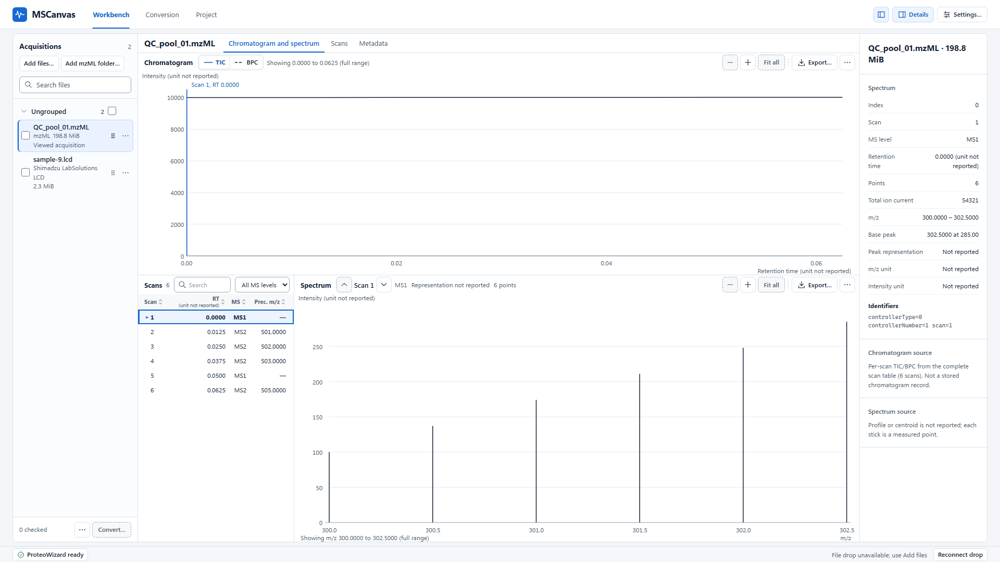
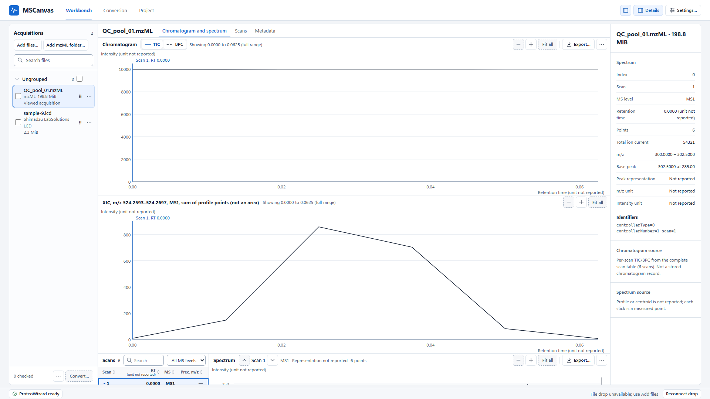
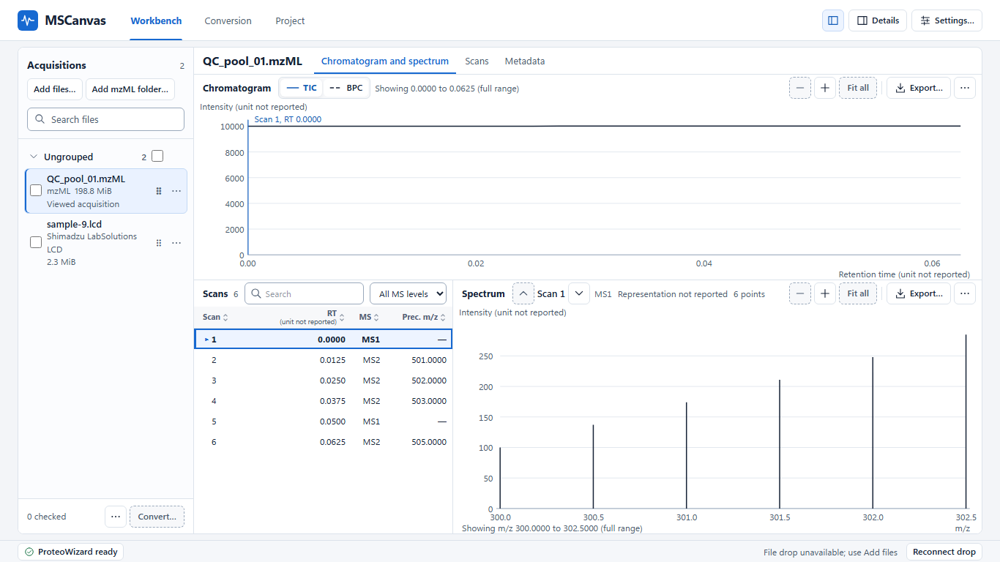
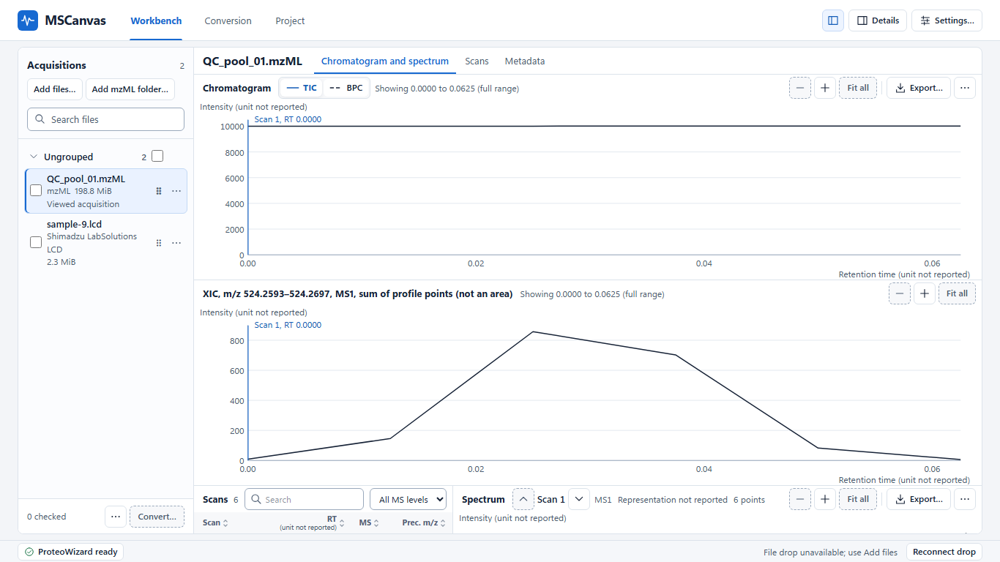
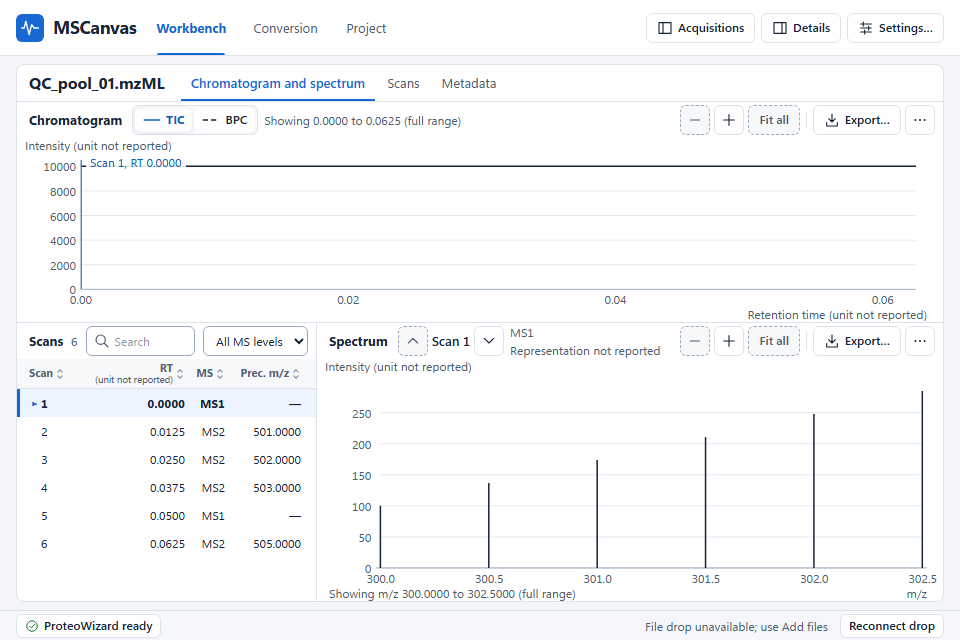
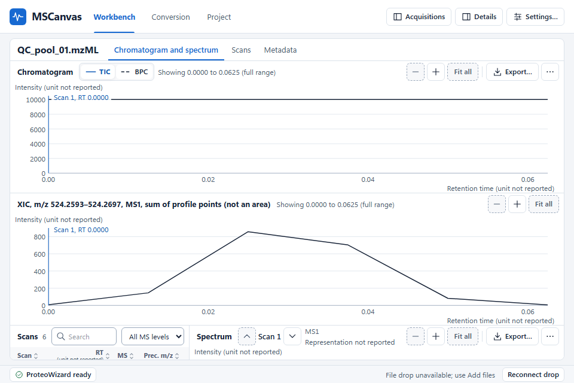

# ADR 0072 — The XIC candidate decision (X3)

Status: **Proposed (2026-11-04).** The owner has not answered it. It proposes
`XIC_PROVIDER_ADMITTED` for candidate C′, and only the owner's acceptance would make
that the outcome. Until then, and after it until X4 and X5 are built under their own
authorization, XIC (VIEW-007) stays unavailable with its stated reason. Documentation
only: the rendering it measures was thrown away. Questions for the owner are
[at the end](#questions-for-the-owner).
Related: [0037](0037-viewer-completion-route.md) (XIC-D5),
[0046](0046-post-m6-xic-provider-runtime-route-lock.md) (the four outcomes),
[0056](0056-project-owned-mzml-reader-for-viewing.md),
[0070](0070-computation-over-decoded-arrays.md) (decision 3's list),
[0071](0071-xic-re-entry-and-its-first-version.md) (decisions 8 and 9, slice X3).
Evidence: [X2](../../spikes/XIC_X2_CANDIDATE_EVIDENCE.md),
[PX.3](../../spikes/PX_3_XIC_COMPARATIVE_EVIDENCE.md). Pattern:
[PX.4](../../spikes/PX_4_XIC_PROVIDER_RUNTIME_DECISION.md).

## Evaluation identity

The evaluated set is **only C′**: the project-owned pass in
`crates/proteowizard/src/mzml_xic.rs`, as ADR 0071 decision 1 defines it. B stays
refused for its own reason ([PX.4](../../spikes/PX_4_XIC_PROVIDER_RUNTIME_DECISION.md)
is not edited). A stays viable, not prototyped, not rejected and outside this set.

| Binding | Exact identity |
| --- | --- |
| Scored executable | `73266bea785a5d71d6498b6c72b905524c9a8491cd8348767e85b14b06bd62ee` |
| Source manifest | `90549b3326a9c2ae82ab9b77c0be6f2da8e83f65ddbadb69937a394e895b5411` |
| Frozen protocol, unchanged | `e3a7340a937d2d48bf968270a538bdf18c36f3a2390e07177f762add503a4b6f` |
| Frozen supplement, unchanged | `3de43a2b748ad9001f2ff9c628773f8669363b449bc4b8fa5956ea8fc0f3967a` |
| Toolchain | rustc and cargo 1.97.1, `x86_64-pc-windows-msvc`, release |

Custody, the runner revisions and the retained evidence are in
[X2](../../spikes/XIC_X2_CANDIDATE_EVIDENCE.md#identity-and-custody).

## Ordered decision

In the order ADR 0046's PX.4 row fixes.

**1. The required evidence is complete, so it is not `EVIDENCE_BLOCKED`.** All 77 rows
ran: 71 synthetic, 4 inherited, 2 representative. All 153 planned invocations ran on one
executable, and every frozen digest and input matched first. The inputs were approved
(ADR 0071 decision 8), and nothing was downloaded.

**2. C′ meets the frozen contract, so it is not `XIC_PROVIDER_REFUSED` on the science.**
77 PASS, 0 FAIL, 0 MISSING. All 30 named cases pass, including every incomplete and mixed
unit case. The legal namespace-prefixed row that decided PX.4 passes. The three fault
controls behave as required, and all 74 repeat groups agree on exact bits. Mutations of
the engine in a throwaway tree failed 22, 1 and 38 of the 73 rows they ran over, so the run
can fail. A fourth, on the integer size rule, failed none of those 73 and 8 of the 17 new
rows. No threshold, precedence or input was relaxed.

**3. It is practical at the observed scale, as proposed here.** No number was set in
advance, as decision 9 requires. On the largest file, 546,327,287 bytes and 43,878
spectra, one window took 4.29 to 11.85 s across three sets on a machine that was never
idle, and the process peaks at about 20 MB, whatever the window's width. The planning
estimate was 5–11 s. Memory grows far more slowly than the file: about 5 MB at 17.7 million
bytes, about 20 MB at 546 million. Every window is still a new full pass, so the judgment
leans on two things X4 owes: progress, and a cancellation that takes effect between
spectra. The limits below are the owner's to weigh, and a different reading of them lands
on `XIC_PROVIDER_REFUSED`, where ADR 0046 puts a measured and impractical candidate.

**4. Its runtime placement is settled, so it is not `ARCHITECTURE_DECISION_REQUIRED`.**
In process, in Rust, behind the existing boundary, on the native-read lane one spectrum
at a time (ADR 0071 decisions 7 and 10, ADR 0046 §4). That is a decision and not yet a
measurement: nothing calls the library.

**5. One candidate survives, so XIC-D4 is not invoked.** No governance choice between
candidates arises.

**Proposed outcome: `XIC_PROVIDER_ADMITTED`, naming C′.** As ADR 0046 says of that
outcome, it implements nothing and does not authorize X4.

## Every row's outcome

The full ledger, with subjects and runs, is
[in X2](../../spikes/XIC_X2_CANDIDATE_EVIDENCE.md#the-ledger). Every row below is PASS.
Each ran twice unless a count says otherwise.

| Group | Rows, all PASS |
| --- | --- |
| Mixed units | `mixed_mz_different`, `mixed_mz_declared_absent`, `mixed_rt_different`, `mixed_rt_declared_absent`, `mixed_intensity_different`, `mixed_intensity_declared_absent`, `px2_mixed_mz` |
| Uniformly absent units | `uniform_absent_mz`, `uniform_absent_rt`, `uniform_absent_intensity`, `px2_absent` |
| Incomplete m/z unit | `incomplete_mz_empty`, `incomplete_mz_whitespace`, `incomplete_mz_name_only`, `incomplete_mz_cvref_only`, `incomplete_mz_name_cvref`, `px2_incomplete_mz_empty` |
| Incomplete RT unit | `incomplete_rt_empty`, `incomplete_rt_whitespace`, `incomplete_rt_name_only`, `incomplete_rt_cvref_only`, `incomplete_rt_name_cvref`, `px2_incomplete_rt_space` |
| Incomplete intensity unit | `incomplete_intensity_empty`, `incomplete_intensity_whitespace`, `incomplete_intensity_name_only`, `incomplete_intensity_cvref_only`, `incomplete_intensity_name_cvref`, `px2_incomplete_int_name` |
| Values and states | `nonfinite_intensity`, `overflow`, `mz_nan_infinity`, `outside_nonfinite`, `overlap_nan`, `overlap_overflow_nonfinite`, `nan_mz_unreadable_intensity`, `precedence`, `arithmetic`, `stored_binary32` |
| The window | `unsorted`, `endpoints`, `zero_width`, `empty_window`, `empty_arrays`, `reversed`, `nan_bound`, `posinf_bound`, `neginf_bound` |
| Scan metadata | `absent_rt`, `undeclared_ms`, `duplicate_rt`, `centroid_declared`, `representation_absent`, `multi_scan_equal`, `rt_missing_value`, `missing_array_list`, `missing_scan_list`, `px2_rt_absent` |
| Document shape | `indexed`, `prefixed`, `truncated`, `px2_truncated`, `inventory_count_mismatch`, `px2_contradictory`, `px2_direct`, `px2_referenced`, `px2_unknown`, `px2_unresolved` |
| Fault controls, one run each | `narrowing_fault`, `identity_fault`, `normalized_metadata_fault` |
| Inherited | `inherited_tiny.pwiz.1.1.mzML`, `inherited_BBM_506_P110_31_MIA_004_30_calibrated.mzML`, `inherited_lowint.mzML`, `inherited_duprt.mzML` |
| Representative, three runs each | `representative_profile`, `representative_centroid` |

`inherited_tiny.pwiz.1.1.mzML` passes with its frozen answer, `Refused`, `MixedUnit:RT`,
under the owner's ISO-8859-1 answer of 2026-11-04, option `narrow`.

Beside the 77 and not in them: **17 new rows on integer arrays, as the owner's answer to
ADR 0071 open question 2 asks, 17 PASS.** They have their own independent reference,
frozen before the candidate's first run on them
([X2](../../spikes/XIC_X2_CANDIDATE_EVIDENCE.md#new-rows-integer-arrays-above-253)).

## The observations

`read_xic` alone, release build, one thread, warm cache, in seconds, each cell three serial
runs. Host: Windows 11, Intel family 6 model 154, 20 logical processors, 63.7 GiB, never
idle. These are observations of one host, never thresholds.

| Source | Bytes | Spectra read / decoded | Points in window | First set | Second set, processor at 86% | Third set, earlier build | Peak working set, all sets (MB) |
| --- | --- | --- | --- | --- | --- | --- | --- |
| Profile representative | 17,703,110 | 931 / 931 | 1,679,804 | 0.249 / 0.233 / 0.232 | 0.284 / 0.378 / 0.306 | 0.156 / 0.162 / 0.144 | 5.2–5.3 |
| Centroid representative | 39,965,112 | 7,602 / 4,627 | 11,090 | 0.751 / 0.885 / 0.726 | 0.867 / 0.956 / 0.861 | 0.419 / 0.402 / 0.415 | 7.9–8.0 |
| R0 profile, narrow window | 546,327,287 | 43,878 / 2,748 | 1,988 | 7.755 / 7.744 / 8.362 | 8.394 / 8.568 / 8.219 | 4.426 / 5.047 / 6.166 | 19.7–19.9 |
| R0 profile, whole scan range | 546,327,287 | 43,878 / 2,748 | 24,744,260 | 8.908 / 7.931 / 8.057 | 8.127 / 11.850 / 11.014 | 4.587 / 4.287 / 4.652 | 19.7–20.0 |

The first two sets are the scored build. The third is an earlier build whose
`crates/proteowizard/src` is the same, and whose source differs only in the example. The
time moved by about a factor of two between sets with the library unchanged. Other work ran
throughout, and load is the likely reason, though only the second set sampled it (mean 86%).
Here a megabyte is 2^20 bytes. The bytes are in the
[X2 record](../../spikes/XIC_X2_CANDIDATE_EVIDENCE.md#release-resource-observations).

**What the practicality judgment does not have:**

- a cold read, a second host, or an idle machine;
- any file larger than R0. If time follows bytes, ADR 0056's 4 GiB document cap, 7.9
  times R0, would take about 34–93 s over the same range. That is arithmetic, not a
  measurement;
- the digest the owner's answer to A0071-Q3 asks for. It adds a read of the whole file to
  every XIC, and its cost is unmeasured;
- the lane handoffs and cancellation latency of X4;
- a real file with FAIMS, or any real integer array.

## XIC-D5: the panel's height, measured

The owner's X-3.2 (2026-11-03, option `panel`) puts the trace in its own panel under the
chromatogram, sharing the retention-time axis, with its own value axis, and states the
height cost as not yet measured. This is that measurement, on the v5.11 layout at
`origin/main` `9f98504e`.

*Where the X-3 answers stand.* ADR 0071 on `main` still lists X-3 as open, because the
records PR that writes the answers there has not merged. The answers are in the owner's
decision table, version 2026-11-03.2, whose reply lists the picks that differ and ends
verbatim "其余按推荐。" ("the rest as recommended"). X-3.1, X-3.2 and X-3.3 are not among
those listed, so each stands at its recommended option: `all`, `panel`, `keep`. A0071-Q3
is in the round-two table of 2026-11-04, answered verbatim "全部按推荐。" ("all as
recommended").

**The rendering was thrown away.** A throwaway worktree rendered a second copy of the
chromatogram panel in the `.viewer-view` grid, in real Chrome over Vite with the backend
mocked at the IPC boundary. Its trace is a synthetic curve on a six-scan fixture, and its
heading is a sample: it shows the form and the height, and no result. Page metrics were
set exactly, with Details and the roster as the app chooses at each size. Its patch is in
the retained evidence, and none of it is merged.

| Page | Viewer column | Chromatogram panel | XIC panel | Lower row, no panel → panel | Spectrum plot, no panel → panel | Spectrum plot on screen before scrolling, with the panel | Free before the lower row hits its floor | Column scroll with the panel |
| --- | --- | --- | --- | --- | --- | --- | --- | --- |
| 1920×1080 | 939 | 426.25 | 427.25 | 512.75 → 240 | 431.75 → 160 | 34.5 | 272.75 | 156 |
| 1366×768 | 627 | 280 | 281 | 347 → 240 | 266 → 160 | 15 | 107 | 175 |
| 960×640 | 499 | 220 | 221 | 279 → 240 | 198 → 160 | 7 | 39 | 183 |

CSS pixels. Without the panel the column does not scroll at any of the three, and the
whole spectrum plot is on screen. No size overflows horizontally.

**What it means.** A panel of the chromatogram's own height takes 221 to 427 px. The
lower row falls to its 240 px floor at all three sizes, so the spectrum plot loses 38 to
272 px. The column then scrolls, and before scrolling only 7 to 34.5 px of the spectrum's
160 px plot are on screen. A panel shorter than the free room avoids the scroll at that
size: the scroll is the panel's height less that free room, to within two pixels of
border and rounding. So a panel of a useful height cannot avoid scrolling at 960×640,
where 39 px are free, or at 1366×768, where 107 px are. Option `panel` is what the owner
chose, and this does not reopen it. The height is
[question 3](#questions-for-the-owner).

| Page | No panel | Panel |
| --- | --- | --- |
| 1920×1080 |  |  |
| 1366×768 |  |  |
| 960×640 |  |  |

## ADR 0070 decision 3's list

The owner's answer of 2026-11-04, option `minimum`, makes this list the minimum each
record states. ADR 0071 has no item-by-item check, so this record gives one for the XIC.
What X1 built is in place. What is marked X4 is not built, and each X4 line is what the
records require, not a design.

1. **Input.** One stated MS level over every spectrum of one mzML file, MS1 in the product
   (ADR 0071 decision 6), with P1's in-scope polarity rule. A sibling pass with its own
   required values, in source order, trusting no index. The viewer's open refusals stand
   in front of it in the product (decision 7).
2. **Operands and bounds.** `XicQuery` holds one level and a closed `[low, high]`, from
   bounds, a half-width or ppm, checked before a spectrum is read. Non-finite or reversed
   bounds and level 0 are refused. The typed input and the exact resolved bounds travel
   with the result. X4: shortest round-trip decimals in the DTO, the export and the
   caption.
3. **Units.** The raw attribute triple on each axis, as declared and never converted. An
   undeclared unit stays not reported. Differing, partly declared or incomplete units
   refuse the whole query, run-wide over every MS level, as frozen.
4. **Profile and centroid.** The declaration is carried and not verified, and nothing is
   centroided. "Sum of profile points, not an area" or "sum of centroid intensities", and
   `point_sum` on the wire (decision 5). Mixing them among in-scope scans refuses the query
   (decision 4). X4 and X5: the displayed name.
5. **No invented values.** Nothing is interpolated, smoothed or filled, and no gap is
   joined. A scan the pass cannot use is a stated state, counted as a gap, and is never
   skipped. There is no fallback. **An empty window differs from the item's words:** ADR
   0046 and the frozen answers make it `Measured`, with sum `+0` and 0 points, and the point
   count says it was empty. ADR 0070's open question 1 left open whether item 5's rules
   bind every record ([question 4](#questions-for-the-owner)).
6. **Arithmetic.** XIC-S3: the exact sum of stored values, one final rounding to binary64,
   `SumNotRepresentable` outside `[-f64::MAX, f64::MAX]`, canonical `+0`. XIC-S4:
   `NonFiniteIntensity` for a non-finite in-window intensity. An integer above 2^53 makes
   its array `Unreadable`, by the owner's answer of 2026-11-03.
7. **Retention.** One spectrum's arrays at a time, within ADR 0056's caps, then only the
   result: one row per spectrum, at most 1,000,000 by the scan limit, each 104 inline bytes
   plus the heap allocations of its identity, which hold its native ID. Those IDs are
   bounded by the 4 GiB document. The per-row heap cost was not measured apart. Measured as
   a whole: about 20 MB peak on R0. No cache, index or copy. X4: where the result is held
   and when it ends.
8. **Running.** A cancellation hook is asked before each spectrum and once after the last,
   and a cancelled pass returns no result. X4: the lane, supersession, the generation
   checks, and progress as spectra read out of the table's count.
9. **Provenance.** The result holds the query as typed and resolved, every row's identity
   and state, the units, the representation and the disclosures. X4: the source and its
   generation, this record's name and the counts, in the DTO and the exports.
10. **Export.** In scope by the owner's X-3.1 (2026-11-03, option `all`): CSV, TSV, SVG, PNG
    and `Copy plot`. Not built. X4: through the shared figure specification and the existing
    no-overwrite path.
11. **Evidence.** The 77 frozen rows and the 17 new rows above, each with an independent
    reference. X1's fixtures for the departures. Time and memory on a real file, a release
    build, and no threshold set in advance.

## What is carried, and by whom

- **A0071-Q3, the owner's answer of 2026-11-04, option `refuse_digest`:** X4 refuses a cut-off
  read whole, as this engine does, and uses a digest to catch an in-place rewrite. Its cost
  is unmeasured (above).
- **X-3.3, option `keep`:** the preview and engine divergences stay, each with its reason in
  the interface. The evidence adds one: this run's `source_metadata` lives in the example, so
  X4's DTO still has to retain the attributes a unit refusal saw (#207's as-built table).
- **ADR 0037's and ADR 0046's obligations for X4 and X5** stay as ADR 0071's Slices section
  cites them.

**As built, not owner decisions:**

- an integer `f64` can represent is refused all the same when it is above 2^53, and negatives
  go by magnitude. The 17 new rows pin this reading;
- every other row of #207's as-built table, where the engine and the oracle would differ on a
  document none of the 77 contains;
- the panel used in the rendering, which took the chromatogram's own height. No record chose
  that height.

## If the owner accepts or refuses

- **Accepted:** C′ is admitted. X4 may then be authorized, on its own, against C′ and nothing
  else, and X5 after X4. VIEW-007 stays unavailable until X5.
- **Refused, as impractical or otherwise:** XIC stays unavailable with a stated reason, under
  ADR 0046's `XIC_PROVIDER_REFUSED`. ADR 0071's other decisions, the merged library and this
  evidence stay as they are, and nothing calls the library.

Either way this changes no frozen artifact, no shipped behaviour, and no earlier record's
outcome for its own candidate.

## Questions for the owner

None is answered. X-1 and X-2 authorized this record, not its outcome.

1. **Admit C′?** Recommended: yes, on the evidence above, with its limits as listed. The
   alternative is `XIC_PROVIDER_REFUSED`, if the observations or their limits are not enough.
2. **Authorize X4, and later X5?** Each is its own authorization (ADR 0071's Slices). X4 is
   2–3 slices and X5 is 2, and neither has been started.
3. **The panel's height in X4.** X-3.2 did not set one and its cost is now measured. (a) The
   chromatogram's own height: both traces equally readable, and the column scrolls 156 to 183
   px at all three sizes, with the spectrum below the fold. (b) A shorter panel, with a floor:
   it avoids the scroll only at the largest size, and its plot is smaller than the
   chromatogram's. No such height was rendered, so this rests on the arithmetic above.
   Recommended: (b), about 270 px at 1920×1080, which X4 must render to confirm that size does
   not scroll, since the layout adds a pixel or two, and accept the scroll at the two smaller
   sizes, where no useful panel fits.
4. **ADR 0070 decision 3, item 5, and the empty window.** The row for ADR 0070's question 1
   left open whether item 5's "an empty window … is not zero" binds every record. ADR 0046 and
   the frozen answers make an XIC's empty window `Measured` with sum `+0` and 0 points.
   Recommended: the XIC keeps the frozen answer, and the interface says "no points in the
   window" where the count is 0.
5. **The integer readings.** A value above 2^53 that `f64` can represent, and the negative side.
   They stay as built until asked. Recommended: as built, since refusing is the conservative
   reading and no intensity of that size has been seen.
